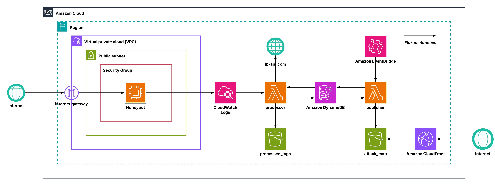
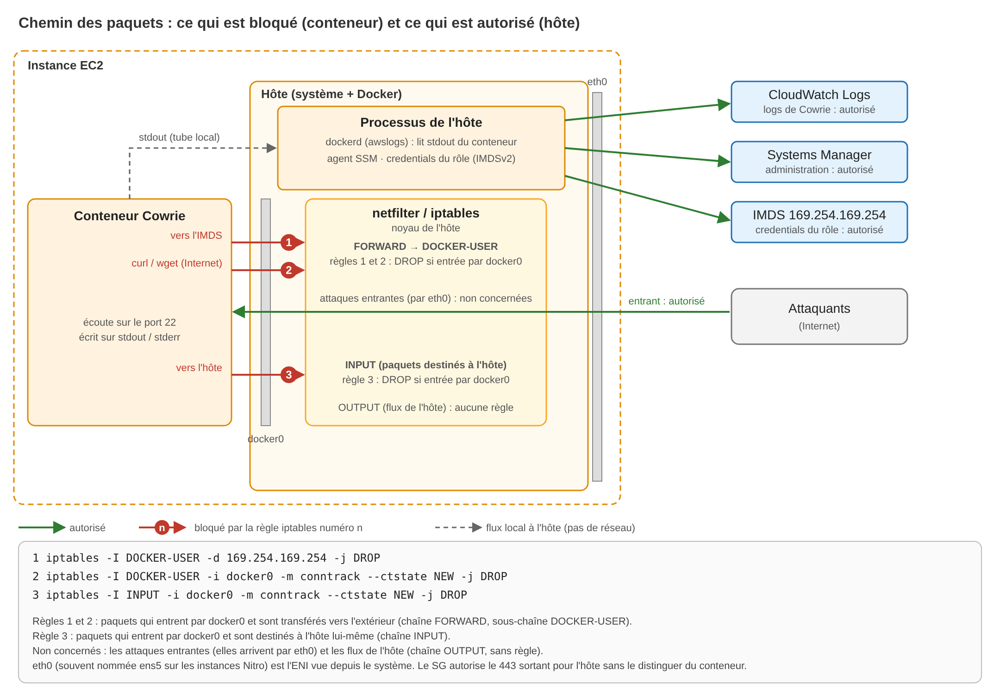
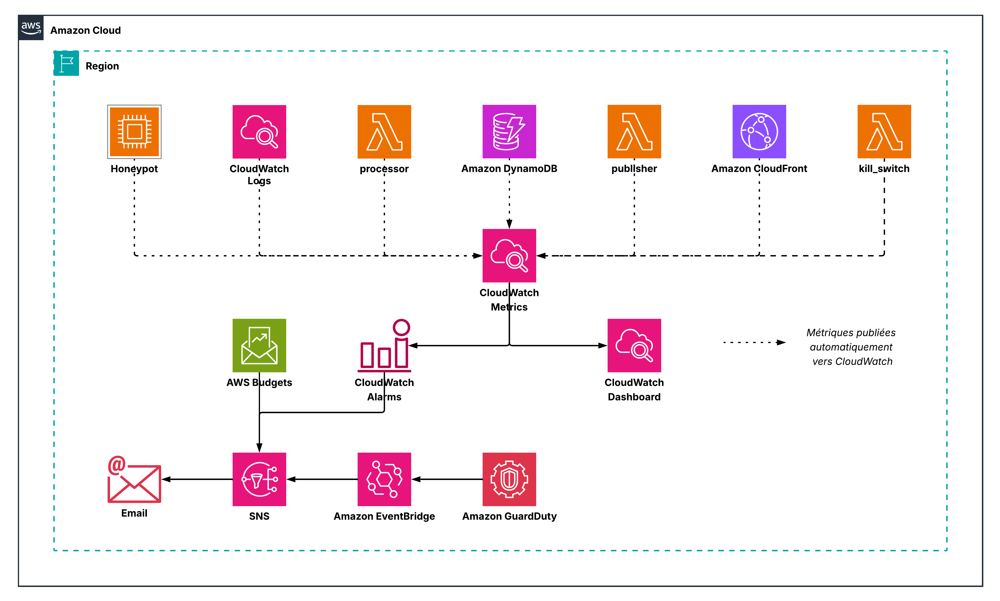
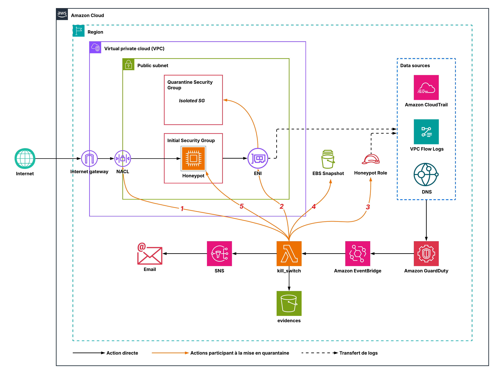

# Phase 2.2 — Version 2 : pipeline incrémental et sécurité renforcée

## Pourquoi une phase 2.2

La phase 2.1 fonctionnait, mais elle n'était pas faite pour durer. À chaque
rafraîchissement de la carte, Athena relisait l'intégralité des logs stockés
dans S3. Tant que j'étais le seul à me connecter, ça ne coûtait presque rien.
Une fois le honeypot ouvert à Internet, la facture et le temps de réponse de la
carte auraient grandi à chaque nouveau log.

Le besoin, lui, n'a quasiment pas changé : une carte 3D des attaques qui se met
à jour toute seule. C'est la solution technique que j'ai revue.

### Compter au fil de l'eau plutôt que tout relire

Plutôt que de relire tout l'historique à chaque fois, je compte les événements
au moment où ils arrivent. Tout le traitement tient maintenant dans une seule
Lambda, le *processor*, déclenchée par CloudWatch à chaque nouveau lot de logs.
Elle :

- lit les lignes du lot ;
- trouve le pays de chaque adresse IP avec l'API ip-api.com ;
- compte les occurrences de ce qui m'intéresse : pays, date et commande tapée ;
- ajoute ces nombres aux compteurs déjà stockés dans DynamoDB ;
- dépose les logs traités dans le bucket S3 `processed_logs`.

Une Lambda peut échouer puis être relancée sur le même lot. Pour ne jamais
compter deux fois, le numéro du lot et les compteurs sont écrits ensemble, dans
deux tables DynamoDB distinctes, par une seule transaction. Si le lot est déjà
enregistré, la transaction est refusée et la Lambda s'arrête là.

Athena et le bucket `processed_logs` restent disponibles pour des analyses
futures, mais la carte n'en dépend plus.

### Une carte alimentée par un petit fichier

Côté carte, EventBridge lance chaque minute une seconde Lambda, le
*publisher*. Elle lit les compteurs et réécrit le fichier `data.json` que la
page affiche.

Ce fichier doit rester petit. Je ne garde donc que le premier mot de chaque
commande (`ls -la` devient `ls`), et seulement s'il s'agit d'une vraie commande.
Tout le reste est rangé dans `other`. Sans ça, chaque commande farfelue tapée
par un attaquant ajouterait une ligne et le fichier grossirait indéfiniment.

Ces valeurs viennent des attaquants : la page les affiche donc toujours avec
`textContent`, jamais avec `innerHTML`.

### Le résultat

Le pipeline coûte beaucoup moins cher et garde les mêmes fonctionnalités. Je ne
peux pas encore chiffrer le coût réel du honeypot une fois ouvert : il y a trop
d'inconnues, à commencer par le volume d'attaques.

Dernier ajustement : la géolocalisation se fait désormais à l'échelle du pays,
plus à la latitude et à la longitude près. Une IP change rarement de pays,
donc j'ai porté la durée du cache GeoIP à 72 heures. Ce chiffre est arbitraire,
mais il limite fortement les appels à ip-api et aide à rester sous sa limite de
45 requêtes par minute.

### Préparer l'ouverture au public

Puisque je reconstruisais, j'en ai profité pour régler l'autre point qui
bloquait l'ouverture à Internet : rien ne limitait les dégâts d'une
compromission. Si un attaquant sortait du conteneur Cowrie ou volait les
credentials de l'instance, aucune barrière ne l'arrêtait et personne n'était
prévenu.

## Objectif

Cette phase vise donc trois choses :

1. **Un traitement au coût constant**, quelle que soit la quantité de logs
   accumulée.
2. **Une instance qui contient un attaquant.** Le conteneur ne peut joindre ni
   Internet, ni l'hôte, ni les credentials du rôle, et Cowrie refuse de
   démarrer si ce n'est pas le cas.
3. **Une détection et une réaction automatiques.** GuardDuty surveille
   l'instance. Si elle attaque à son tour ou si ses credentials sont utilisés
   ailleurs, un *kill switch* la met aussitôt en quarantaine, garde les preuves
   et prévient par email.

Le honeypot reste accessible depuis mon IP uniquement. L'ouverture au public
est l'objet de la phase 3.

## Schémas d'architecture

### Capture, traitement et publication des données



- Cowrie écrit son log sur la sortie standard, que Docker envoie directement à
  **CloudWatch Logs**.
- Chaque lot de logs déclenche la Lambda **processor**. Elle :
  - reconnaît les connexions, les tentatives de login et les commandes ;
  - trouve le pays de chaque IP avec **ip-api.com**, en gardant le résultat 72 h
    en cache dans DynamoDB ;
  - incrémente des compteurs par pays, par jour et par commande dans
    **DynamoDB** ;
  - écrit les événements normalisés dans le bucket **processed_logs**, que
    Athena peut interroger à la main.
- Le comptage est idempotent : CloudWatch peut livrer deux fois le même lot,
  mais il n'est compté qu'une fois.
- Chaque minute, **EventBridge** lance la Lambda **publisher**. Elle lit les
  compteurs et réécrit `data.json` dans le bucket **attack_map**.
- **CloudFront** sert la carte et `data.json` sans mise en cache, et la page
  relit les données toutes les 60 secondes.

### Isolation du conteneur sur l'hôte



Trois règles `iptables` bloquent toute nouvelle connexion qui part du
conteneur : vers IMDS (les credentials du rôle), vers Internet et vers l'hôte.
Les attaques entrantes, elles, passent normalement. L'hôte garde ses propres
accès (CloudWatch, Systems Manager, IMDS).

Ces règles sont complétées par trois autres protections :

- **IMDSv2 avec un hop limit de 1** : les réponses de métadonnées n'atteignent
  pas le conteneur.
- **Un test de sortie avant chaque démarrage de Cowrie** : un conteneur témoin
  doit échouer à joindre Internet et IMDS, sinon Cowrie ne démarre pas.
- **Un vrai serveur SSH masqué** : l'administration passe uniquement par
  Systems Manager.

### Supervision



Toutes les métriques remontent dans CloudWatch, et un dashboard les regroupe :
Lambdas, volume de logs, DynamoDB, EC2 et CloudFront.

Toutes les alertes arrivent par email via un seul topic SNS :

- **cinq alarmes** : volume de logs anormal, erreurs du processor, erreurs et
  throttles du kill switch, file d'erreurs non vide ;
- **le budget** mensuel de 10 $ ;
- **tous les findings GuardDuty**.

### Kill switch



GuardDuty analyse CloudTrail, les VPC Flow Logs et les requêtes DNS. Deux règles
EventBridge, filtrées sur l'ID de l'instance, déclenchent la Lambda
**kill_switch** dans deux cas :

- **l'instance est à l'origine** d'une activité malveillante (malware, minage,
  scan de ports, Tor). Un honeypot est attaqué en permanence : un finding où il
  est seulement la cible ne déclenche rien ;
- **les credentials du rôle de l'instance sont utilisés hors de l'instance.**

La Lambda est hors du VPC, pour rester joignable même quand le réseau du
honeypot est coupé. Elle enchaîne alors les actions du schéma, chacune
indépendante des autres :

1. **Refus de tout le trafic** dans le NACL du sous-réseau. Le NACL est sans
   état, donc les connexions déjà établies sont coupées aussi.
2. **Remplacement du security group de l'instance** par un groupe vide.
3. **Policy `Deny *` attachée au rôle de l'instance** : des credentials volés
   deviennent inutiles.
4. **Snapshots des disques** pour l'analyse.
5. **Arrêt de l'instance**, jamais sa suppression.

En plus de ces actions, la Lambda pose un tag `Quarantine` sur l'instance et
copie le finding GuardDuty dans le bucket **evidences** (chiffré, conservé
90 jours). Chaque action envoie un email. Si l'une échoue, la Lambda termine en
erreur et une alarme le signale. La remise en service suit le
[runbook de restauration](Runbook_sortie_quarantaine.md).

## Sécurité mise en place

- **Accès réseau** limité à mon IP, à la fois par le security group et par un
  NACL dédié au sous-réseau.
- **Rôle de l'instance réduit au minimum** : il peut seulement écrire dans son
  propre groupe de logs, plus l'accès Systems Manager.
- **Rôles des Lambdas au moindre privilège.** Le publisher ne peut écrire que
  `data.json`, jamais `index.html`. Le kill switch ne peut attacher que la
  policy `Deny *`, n'agit que sur cette instance et ne peut pas la supprimer.
- **Commandes des attaquants traitées comme des données non fiables.** Seul le
  premier mot est conservé, s'il figure dans une liste blanche d'environ
  90 commandes, sinon il devient `other`. La page les affiche en texte brut
  (`textContent`, jamais `innerHTML`).
- **Réponse d'ip-api validée.** ip-api est appelé en HTTP, donc seul un code
  pays de deux lettres majuscules est accepté.
- **Buckets privés.** La carte n'est accessible que par CloudFront (Origin
  Access Control).

## Ce que compte la carte

Contrairement à la phase 2.1, la carte compte désormais les **connexions**, les
**tentatives de login** et les **commandes**. Les pays et les dates cumulent les
trois. Le classement des commandes, lui, ne compte que les commandes tapées.

## La migration en 8 étapes

Le passage de la version 2.1 à la version 2.2 s'est fait en 8 étapes, appelées
phases 1 à 8 dans le plan de migration. Une étape 0 de préparation les précède.
Chaque étape se termine par un `terraform plan` sans différence avant de passer
à la suivante.

| Étape | Contenu | Ce qu'elle apporte |
|---|---|---|
| 1 | Alertes et garde-fous financiers | Topic SNS par email, budget de 10 $, rétention des logs à 14 jours, rôles Lambda resserrés |
| 2 | Durcissement de l'instance | IMDSv2, rôle minimal, règles `iptables`, test de sortie avant le démarrage de Cowrie, services systemd qui survivent à un reboot |
| 3 | NACL dédié | Deuxième filtre réseau au niveau du sous-réseau, numéros 1 à 9 réservés au kill switch |
| 4 | Lambda processor | Comptage incrémental et idempotent dans DynamoDB, suppression de l'ancien pipeline et des requêtes Athena planifiées |
| 5 | Lambda publisher et carte | `data.json` régénéré chaque minute, servi sans cache, défense contre le XSS |
| 6 | Supervision et GuardDuty | Dashboard, alarmes, GuardDuty en notification seulement |
| 7 | Kill switch, sans déclencheur | Toute l'infrastructure de quarantaine, testée d'abord en simulation |
| 8 | Kill switch réel | Règles EventBridge branchées, mode réel activé, exercice d'incident complet puis restauration |

## Prouver que ça fonctionne

En réalité, j'ai effectué des tests au fûr et à mesure de l'implémentation de chaque phase. Afin de simplifier le repertoire et sa lecture, j'ai décidé de ne pas montrer l'évolution du code étape par étape. 

Les tests réalisés à chaque étape sont donc regroupés dans un seul script,
[`verify_deployment.py`](verify_deployment.py). Il vérifie le déploiement réel
sur AWS, étape par étape, et affiche une ligne OK ou ECHEC par test.

```bash
python3 verify_deployment.py               # lecture seule, toutes les étapes
python3 verify_deployment.py --phase 2 5   # seulement les étapes 2 et 5
python3 verify_deployment.py --actif       # ajoute les tests qui écrivent dans AWS
python3 verify_deployment.py --sans-plan   # sans le terraform plan
```

**En lecture seule**, le script vérifie notamment :

- **l'instance** : IMDS refusé sans jeton, conteneur incapable de sortir,
  règles `iptables` en place, `sshd` masqué. Ces contrôles sont lancés sur
  l'instance via Systems Manager ;
- **le réseau** : les règles du NACL et du security group ;
- **les droits IAM**, par simulation : le publisher ne peut pas toucher
  `index.html`, et le kill switch ne peut ni supprimer l'instance ni attacher
  une autre policy ;
- **la carte** : `data.json` est récent et jamais servi depuis le cache ;
- **les déclencheurs** : les motifs des règles EventBridge sont testés sur 9
  findings fabriqués.

**Avec `--actif`**, il ajoute des tests qui écrivent dans AWS :

- **le processor** reçoit des lignes Cowrie fabriquées. Le script vérifie la
  normalisation des commandes, l'idempotence au rejeu, deux lots simultanés, le
  cache GeoIP et le découpage d'un lot de 110 clés. Il retire ensuite
  exactement ce que ces lignes ont compté ;
- **la défense XSS** : un libellé piégé est inséré, puis supprimé ;
- **les alarmes** sont forcées puis remises à OK ;
- **GuardDuty** génère des findings d'exemple ;
- **le port 22** reçoit une connexion depuis mon IP.

Ce mode envoie des emails.

Le kill switch n'est jamais déclenché par le script. Son exercice réel arrête
l'instance et reste une procédure manuelle, décrite dans le runbook.

<!-- Coller ici la sortie de : python3 verify_deployment.py -->

## Limites connues

- **Format des logs.** Cowrie envoie son log texte, pas son log JSON. Le
  processor le lit par expressions régulières : un changement de format de
  Cowrie demanderait d'adapter ces expressions.
- **Commandes simplifiées.** Seul le premier mot de chaque commande est gardé,
  donc `ls; rm -rf /` devient `other`. Le texte complet reste uniquement dans
  CloudWatch Logs, pendant 14 jours. Il faudra le conserver autrement pour
  l'analyse de la phase 4.
- **GeoIP gratuite.** ip-api est limité en débit. Au-delà de 10 nouvelles IP
  par lot, les suivantes passent en `Unknown` jusqu'au lot suivant.
- **Budget sans plafond.** Le budget prévient, il ne bloque aucune dépense.
- **Pas de CI/CD.** L'état Terraform est local et le déploiement manuel.

## Pour les curieux arrivés jusq'ici 

Vous vous demandez peut-être pourquoi est-ce que je n'utilise pas AWS Firehose pour faire le lien entre l'instance EC2 et la lambda *processor*. La raison est très simple, j'ai souhaité conserver mon plan AWS Free-Tier le plus longtemps possible afin de bénéficier des crédits gratuits et il se trouve que le service Firehose nécessite le plan payant...

Au cours du déploiement, mon plan free-tier a expiré, ce qui explique que j'utilise AWS GuardDuty, qui appartient bien au plan payant.

## Fichiers de cette phase

- [`main.tf`](main.tf) : toute l'infrastructure Terraform, avec le code des
  trois Lambdas embarqué.
- [`index.html`](index.html) : la page de la carte.
- [`verify_deployment.py`](verify_deployment.py) : le script de vérification du
  déploiement.
- [`Runbook_sortie_quarantaine.md`](Runbook_sortie_quarantaine.md) : la remise en service de l'instance après une quarantaine.
- [`media/`](media/) : les schémas d'architecture.
